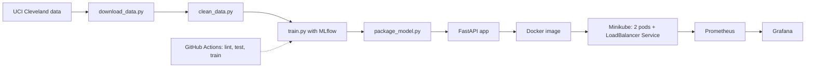

# Heart Disease Prediction: MLOps Assignment 1

TODO: one or two sentences in your own words on what this project does.

Repository: https://github.com/makerhome461/heart-disease-mlops

## Architecture



## Setup

```bash
python3 -m venv .venv
source .venv/bin/activate
pip install -r requirements.txt
python scripts/download_data.py
python src/clean_data.py
python src/eda.py
python src/train.py
python src/package_model.py
pytest -v
```

## Run the API locally

```bash
uvicorn --app-dir src app:app --port 8000
curl -X POST http://127.0.0.1:8000/predict -H "Content-Type: application/json" \
  -d '{"age":63,"sex":1,"cp":1,"trestbps":145,"chol":233,"fbs":1,"restecg":2,"thalach":150,"exang":0,"oldpeak":2.3,"slope":3,"ca":0,"thal":6}'
```

## Docker

```bash
docker build -t heart-api:1.1 .
docker run -d -p 8000:8000 heart-api:1.1
```

## Kubernetes (Minikube)

```bash
minikube start --driver=docker
minikube image load heart-api:1.1
minikube kubectl -- apply -f k8s/
minikube kubectl -- apply -f k8s/monitoring/
minikube service heart-api --url
```

## EDA and modelling choices

TODO: your own notes (class balance, correlations, why Logistic Regression vs Random Forest).

## Experiment tracking summary

TODO: your own words. Facts: 9 MLflow runs, 5-fold stratified CV, ROC-AUC 0.895 to 0.909, recall 0.765 to 0.780. Final model: Logistic Regression, C=1.0.

## CI/CD

GitHub Actions workflow `.github/workflows/ci.yml`: lint (flake8), data prep, pytest, training, artifact upload. First run failed on lint, then passed.

## Monitoring

API logs every request. Prometheus scrapes `/metrics` from both pods; Grafana dashboard "Heart API monitoring".

## Screenshots

See the `screenshots/` folder.

## AI use

TODO: add a line if your course requires disclosing AI assistance, for example how you used it.
