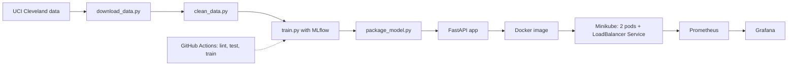

# Heart Disease Prediction: MLOps Assignment 1

This project predicts whether a patient is likely to have heart disease from 13 clinical measurements, using the Cleveland subset of the UCI Heart Disease dataset. The model is trained with tracked experiments, tested and built automatically with GitHub Actions, packaged in a Docker image, deployed on Kubernetes (Minikube) as a FastAPI service, and monitored with Prometheus and Grafana.

Repository: https://github.com/makerhome461/heart-disease-mlops

## Architecture



## Setup

```bash
python3 -m venv .venv
source .venv/bin/activate
pip install -r requirements.txt
python scripts/download_data.py
python src/clean_data.py
python src/eda.py
python src/train.py
python src/package_model.py
pytest -v
```

## Run the API locally

```bash
uvicorn --app-dir src app:app --port 8000
curl -X POST http://127.0.0.1:8000/predict -H "Content-Type: application/json" \
  -d '{"age":63,"sex":1,"cp":1,"trestbps":145,"chol":233,"fbs":1,"restecg":2,"thalach":150,"exang":0,"oldpeak":2.3,"slope":3,"ca":0,"thal":6}'
```

## Docker

```bash
docker build -t heart-api:1.1 .
docker run -d -p 8000:8000 heart-api:1.1
```

## Kubernetes (Minikube)

```bash
minikube start --driver=docker
minikube image load heart-api:1.1
minikube kubectl -- apply -f k8s/
minikube kubectl -- apply -f k8s/monitoring/
minikube service heart-api --url
```

## EDA and modelling choices

The raw data has 303 rows. Six rows had missing values in ca and thal, so I dropped them, leaving 297. I converted the 0 to 4 target into a binary label (0 = no disease, 1 = disease), which gives 160 patients without disease and 137 with it, so the classes are roughly balanced. About 68% of the patients are male, and cholesterol has a maximum of 564 against a median of 243, so there is at least one extreme value. I scaled the numeric features (age, trestbps, chol, thalach, oldpeak, ca) and one-hot encoded cp, restecg, slope and thal, because their numbers are category codes rather than amounts. All preprocessing sits inside a scikit-learn pipeline, so each cross-validation fold learns its scaling and encoding only from its own training data. I compared Logistic Regression, a simple and explainable baseline, with Random Forest, which can capture non-linear patterns.

## Experiment tracking summary

I logged nine runs to MLflow: three Logistic Regression runs (C = 0.1, 1, 10) and six Random Forest runs (max depth 3, 5, 8, each with 100 or 200 trees). Each run used 5-fold stratified cross-validation, and MLflow stored its parameters, the mean and standard deviation of accuracy, precision, recall and ROC-AUC, plus an ROC curve and a confusion matrix. ROC-AUC ranged from 0.895 to 0.909 and recall from 0.765 to 0.780, while scores varied by roughly 0.04 to 0.08 between folds, so the differences between runs are within noise. I chose Logistic Regression with C = 1.0 as the final model because it performed about as well as the Random Forests and is simpler to explain.

## CI/CD

GitHub Actions workflow `.github/workflows/ci.yml`: lint (flake8), data prep, pytest, training, artifact upload. First run failed on lint, then passed.

## Monitoring

API logs every request. Prometheus scrapes `/metrics` from both pods; Grafana dashboard "Heart API monitoring".

## Screenshots

See the `screenshots/` folder.

## AI use

I used an AI assistant (Claude) for guidance on setup, debugging and starter code, and for reviewing my writing. I ran, tested and deployed everything myself and chose the final model from my own experiment results.